 

## Services

<table>
<tr>
<td width="50%" valign="top">

### Content automation
Script, voiceover, visuals, captions, assembly and scheduled posting across YouTube, TikTok, Instagram and Facebook.

</td>
<td width="50%" valign="top">

### AI-assisted tools
Custom assistants and workflows built with Python, JavaScript and LLM APIs (Claude).

</td>
</tr>
<tr>
<td width="50%" valign="top">

### Short-form video and animation
Faceless, story-driven Shorts, Reels and TikToks built for retention and monetization.

</td>
<td width="50%" valign="top">

### Channel growth
Hooks, pacing, posting cadence and analytics-minded iteration, learned from running my own channels.

</td>
</tr>
</table>

## Track record

## Selected projects

| Project | Description | Stack |
|---|---|---|
| [**yta-fba-studio**](https://github.com/gendesu4work/yta-fba-studio) | YTA and FBA Studio by NEXUS MEDIA: niche to scheduled short-form animations | JavaScript |
| [**lowpolyanimation**](https://github.com/gendesu4work/lowpolyanimation) | Fully automated low poly animator, ready for posting on 4 social platforms | HTML |
| [**jarvis**](https://github.com/gendesu4work/jarvis) | Personal AI assistant | Python |

## Tech

## Contribution snake

<picture>
  <source media="(prefers-color-scheme: dark)" srcset="https://raw.githubusercontent.com/gendesu4work/gendesu4work/output/snake-dark.svg"/>
  
</picture>

## Work with me

Need a content pipeline, an automation tool, or a short-form video system built? Message me through **[nexusmediaph.com](https://nexusmediaph.com)**.

